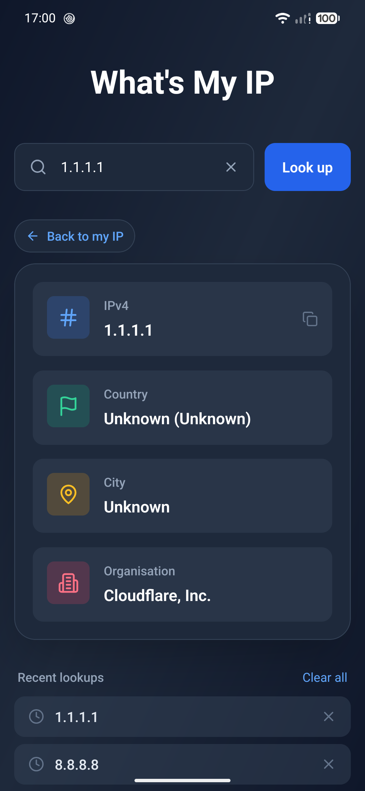

# What's My IP

Android app for [ip.sprytnyk.dev](https://ip.sprytnyk.dev), with the same design as the site. It shows your
public IPv4 and IPv6 addresses, country, city and network organisation, and can look up any
other address.

<p align="center">
  
</p>

## Privacy

Neither the app nor its backend collects your data.

- **No tracking.** No analytics, ads, crash reporting or accounts.
- **One server.** The app only talks to `ip.sprytnyk.dev` and its `ipv4.`/`ipv6.` subdomains.
  Footer links open in a browser only when you tap them.
- **Local GeoIP.** The [backend](https://github.com/sprytnyk/ip) answers from local MaxMind
  GeoLite2 databases, so your address is never passed on to a third-party lookup service.
- **History stays on your phone.** Recent lookups are stored on the device only, and you can
  clear them at any time.
- **Self-hostable.** The backend is open source. Point the app at your own instance by changing
  `API_HOST` in `src/lib/api.ts`.

## Develop

```bash
npm install        # also installs the git hooks (husky)
npx expo start     # scan the QR code with Expo Go on Android
```

## Checks

```bash
npm run lint       # ESLint (eslint-config-expo) + Prettier
npm run typecheck  # tsc --noEmit
npm run format     # Prettier --write
```

The pre-commit hook runs lint-staged: `eslint --fix` and Prettier on staged files, then a
project-wide `tsc --noEmit`.
